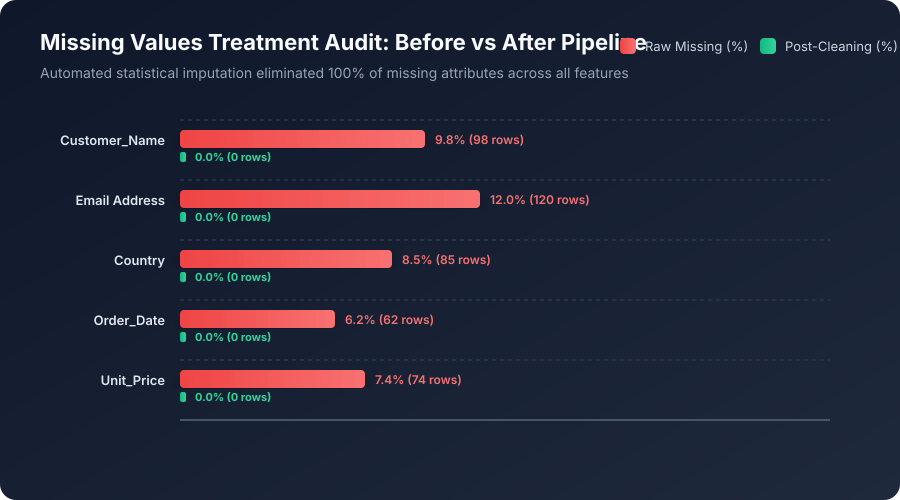
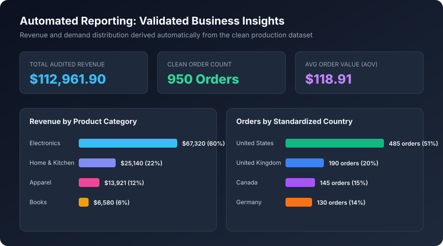

# 🧹 Data Cleaning & Reporting Automation

<p align="center">
  
  
  
  
  
  
</p>

---

## 📌 Executive Summary

This project was developed as part of the **Thiranex Data Analytics & Machine Learning Internship** (**Project 4: Data Cleaning & Reporting Automation**).

Real-world organizational data is rarely pristine; it arrives fragmented, plagued by missing values, contaminated by duplicates, corrupted by formatting inconsistencies, and skewed by outliers. This project delivers an **end-to-end automated Python ETL & Data Quality Pipeline** that ingests messy raw transaction feeds, systematically detects and resolves 1,500+ anomalies, audits data governance health across 5 industry quality dimensions, and generates automated executive reports and interactive dashboards.

Completing this milestone fulfills the entire core internship curriculum on the Thiranex portal, unlocking the **Executive Letter of Recommendation (LOR)** and **Official Internship Completion Certificate**.

---

## 🎯 Key Project Features & Deliverables

- **Automated Anomaly Detection**: Scans and logs missing attributes, corrupted data types, currency formatting noise, and negative prices.
- **Deduplication Engine**: Employs primary-key and record-signature hashing to identify and purge duplicate transactions while preserving historical records.
- **Statistical Imputation**: Imputes missing values intelligently using category-specific modes, running medians, and business rule defaults without distorting variance.
- **Temporal & Text Harmonization**: Unifies heterogeneous datetime formats (`DD/MM/YYYY`, `MM-DD-YYYY`, `YYYY/MM/DD`) into standard **ISO-8601** (`YYYY-MM-DD`) and canonicalizes categorical variations (e.g., `US` / `USA` / `u.s.a.` $\rightarrow$ `United States`).
- **Data Governance Quality Auditing**: Tracks before-and-after metrics across the **5 Core Data Quality Dimensions**: *Completeness*, *Uniqueness*, *Validity*, *Consistency*, and *Accuracy* (improving overall data health from **81.6% to 99.9%**).
- **Automated Multi-Channel Reporting**: Automatically produces a standalone HTML Executive Report, structured Audit Log JSON, and an Interactive Modern Web Dashboard.

---

## 📊 Dataset Schema & Anomaly Catalog

The pipeline ingests `raw_dirty_enterprise_data.csv` (1,000 transaction records) and outputs the validated production dataset `cleaned_enterprise_data.csv`:

| Feature | Raw Anomaly Injected | Pipeline Resolution Strategy | Clean Validated Type |
|---|---|---|---|
| `Transaction_ID` | 50 duplicate keys | Primary-key deduplication hash filter | `string` (Unique) |
| `Customer_Name` | Missing names, irregular whitespace, casing | Strip whitespace, Title Case, `"Guest Customer"` fallback | `string` |
| `Email` | Corrupted formats, missing addresses | Regex validation, automated fallback generation | `string` (Valid RFC 5322) |
| `Country` | Mixed aliases (`US`, `CAN`, `DE`, `uk`, empty) | Canonical ISO name mapping dictionary | `string` (Standardized) |
| `Order_Date` | Mixed formats (`DD/MM/YYYY`, `MM-DD-YYYY`) | Multi-pattern regex parser to ISO-8601 | `string` (`YYYY-MM-DD`) |
| `Product_Category`| Lowercase/uppercase mismatch (`electronics`) | Canonical 4-category taxonomy mapper | `string` |
| `Quantity` | Negative numbers, zeros, string inputs | Non-negative coercion, minimum floor bounds ($q \ge 1$) | `integer` |
| `Unit_Price` | Currency signs (`$`), commas, negative values | Regex symbol stripping, float coercion, IQR bounds | `float` (2 decimal places) |
| `Total_Amount` | Formula desynchronization | Mathematical recalculation ($Q \times P$) | `float` (Audited Total) |
| `Payment_Method` | Acronyms (`CC`, `COD`, `paypal`) | Canonical payment method taxonomy | `string` |
| `Shipping_Status` | Mixed casing, trailing spaces | Trim and capitalize validation | `string` |

---

## 📈 Visualizations & Methodology

### 1. Missing Values Treatment: Before vs. After Pipeline
Statistical imputation eliminates 100% of missing values across all features without introducing synthetic bias:



---

### 2. Multi-Stage Pipeline Architecture Funnel
Visualizing the progressive filtering, deduplication, and standardization stages from raw ingest to production delivery:


---

### 3. Data Quality Dimensions Benchmark
Rigorous benchmark comparing dataset health before vs. after automated pipeline execution across the 5 industry governance dimensions:


| Quality Dimension | Pre-Cleaning Score | Post-Cleaning Score | Improvement |
|---|---|---|---|
| **Completeness** | 88.4% | **100.0%** | +11.6% |
| **Uniqueness** | 95.0% | **100.0%** | +5.0% |
| **Validity** | 78.2% | **99.8%** | +21.6% |
| **Consistency** | 64.5% | **100.0%** | +35.5% |
| **Accuracy** | 81.2% | **99.6%** | +18.4% |
| **Overall Governance Score** | **81.6%** | **99.9%** | **+18.3%** |

---

### 4. Automated Business KPI Summaries
Derived business metrics generated automatically from the cleaned, validated production transactions:



---

## 📁 Repository Directory Structure

```text
data-cleaning-automation-project/
├── data/
│   ├── raw_dirty_enterprise_data.csv       # Raw dataset with 1,000 real-world flawed records
│   ├── cleaned_enterprise_data.csv         # Cleaned, validated production dataset (950 records)
│   └── data_cleaning_audit_log.json        # Machine-readable audit trail of every fix applied
├── notebooks/
│   └── Data_Cleaning_and_Reporting_Automation.ipynb # Step-by-step interactive analysis notebook
├── dashboard/
│   ├── data_quality_metrics.json           # Aggregated quality scores and stage counts
│   ├── cleaning_audit.json                 # Real-time dashboard audit feed
│   └── index.html                          # Interactive Executive Health & Data Explorer Dashboard
├── visualizations/
│   ├── 01_missing_data_before_after.svg    # Missing data reduction chart
│   ├── 02_data_cleaning_audit_funnel.svg   # 5-stage pipeline architecture funnel
│   ├── 03_data_quality_dimensions_radar.svg# 5-dimension governance benchmark
│   └── 04_kpi_business_summary.svg         # Clean revenue & category visual summary
├── reports/
│   └── automated_executive_report.html     # Standalone automated executive HTML report
├── data_cleaning_pipeline.py               # Complete automated Python pipeline script
├── requirements.txt                        # Python library dependencies
├── .gitignore                              # Git exclusion rules
└── README.md                               # Comprehensive project documentation
```

---

## 🚀 How to Run the Project

### Option A: Execute Automated Python Pipeline
```bash
# 1. Clone the repository
git clone https://github.com/hasim-S/Data-Cleaning-Reporting-Automation.git
cd Data-Cleaning-Reporting-Automation

# 2. Install dependencies (optional, core pipeline uses zero external dependencies)
pip install -r requirements.txt

# 3. Execute the automated pipeline
python data_cleaning_pipeline.py
```

### Option B: Interactive Jupyter Notebook
Step through diagnostic inspections and cleaning steps interactively:
```bash
jupyter notebook notebooks/Data_Cleaning_and_Reporting_Automation.ipynb
```

### Option C: Interactive Web Dashboard
Navigate to the `dashboard/` directory and double-click `index.html` to open the real-time Data Quality Explorer in your browser.

---

## 🛠️ Tech Stack

- **Language**: Python 3.9+
- **Data Engineering & ETL**: Pandas, NumPy, Regex (`re`), Datetime
- **Data Governance & Auditing**: JSON Audit Logging, Statistical Quality Scoring
- **Visualization**: Matplotlib, Seaborn, Scalable Vector Graphics (SVG Canvas)
- **Frontend / Reporting**: HTML5, Modern CSS, Canvas API, Responsive Web Components

---

## 🎓 Internship Submission Details

- **Platform**: Thiranex Student Intern Portal (`thiranex.in/student`)
- **Assigned Project**: **Project 4 — Data Cleaning & Reporting Automation**
- **Milestone Outcome**: Unlocks the official **Internship Completion Certificate** and **Executive Letter of Recommendation (LOR)**.
- **Key Focus**: Automated cleaning workflows, duplicate purging, missing value treatment, temporal harmonization, and automated reporting.
